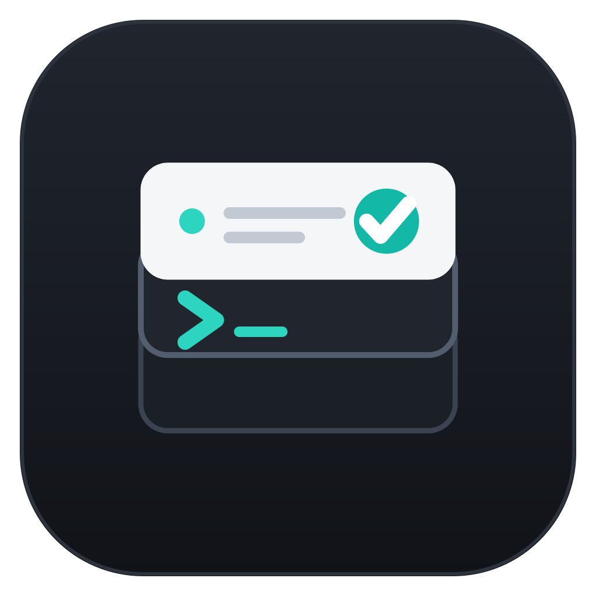

# OpenCode API Manager

<p align="center">
  
</p>

<p align="center">
  <strong>Discover, compare and register OpenCode models without touching
  your API keys.</strong>
</p>


## What it is

A **Python / PyQt6** desktop app for [OpenCode](https://opencode.ai/).
It keeps two layers apart:

- **The catalog** — providers and models with protocol, endpoint, context
  window, capabilities and prices, fed by [Models.dev](https://models.dev)
  (MIT) plus a local seed and cache. It is **not your configuration**.
- **`opencode.json`** — what OpenCode reads. Only what you register is
  written there, with an automatic backup before every save.

Search and browse without writing anything; a model reaches your
configuration only when you press **Agregar a OpenCode** (“Add to
OpenCode”).

## Why use it

- **Instant search and combinable filters** over thousands of models,
  even names, IDs, endpoints and tags.
- **Real data only**: unknown context, limits or prices are labelled as
  unknown instead of invented.
- **One-click registration** of a model or a whole provider, preserving
  what you already wrote by hand.
- **Connection test** (`Ctrl+T`) that asks the provider for its model
  list without spending tokens and diagnoses DNS, TLS, HTTP and auth
  errors honestly.
- **Global or per-repository configuration**, with atomic saves, dated
  backups and detection of external edits.
- **Light and dark themes**, keyboard shortcuts and a provider → model
  tree collapsed by default.
- **Your credentials stay out of it**: the app never reads or writes
  `auth.json`, never shows or stores API keys and never sends them to a
  catalog provider.

> The interface is in Spanish; the documentation is in English.

## Quick start

You need **Python 3.10+** and **PyQt6**:

```bash
python3 -m venv .venv
source .venv/bin/activate          # Windows: .venv\Scripts\activate
python3 -m pip install PyQt6
python3 opencode_model_manager.py
```

On first launch the app looks for your `opencode.json`
(`OPENCODE_CONFIG` → project → global) and offers to create a basic one
if it does not exist.

For a headless check (SSH/CI), the test suite and a Portuguese guide, see
[Run and test from the terminal](docs/terminal.md).

## Use it in five steps

1. **Pick the file.** Global mode edits
   `~/.config/opencode/opencode.json`; untick **Modo global** for the
   current repository's file, or open any file with **Abrir…** (`Ctrl+O`).
2. **Search and filter** in the header; every control applies instantly.
3. **Open the card** of a model (click or `Enter`) to see what is really
   known about it.
4. **Register it** with **Agregar a OpenCode**, or set it as `model` /
   `small_model`.
5. **Save** with `Ctrl+S`. The app validates, backs up and writes
   atomically.

## Documentation

| Document | Contents |
|---|---|
| [Features](docs/features.md) | Complete list of what the app does |
| [Usage](docs/usage.md) | Interface, catalog, search and filters, model card, provider dialog, connection test, shortcuts |
| [Configuration](docs/configuration.md) | Global vs repository mode, saving and backups, external changes, greyed-out removal, migration, LSP |
| [Security](docs/security.md) | Credential rules and what the tests guarantee |
| [Architecture](docs/architecture.md) | Modules and design rules |
| [Tests](docs/testing.md) | The 344-test suite in its two layers |
| [Terminal](docs/terminal.md) | Install, headless check and Portuguese guide |
| [Background](docs/background.md) | Why it exists: OpenCode and free B.AI models |

## Credits

- [OpenCode](https://opencode.ai/) and its
  [documentation](https://opencode.ai/docs/)
- [Models.dev](https://models.dev) catalog (MIT)
- [B.AI](https://chat.b.ai/) · [API key](https://chat.b.ai/key)
- Built with [PyQt6](https://www.riverbankcomputing.com/software/pyqt/)
